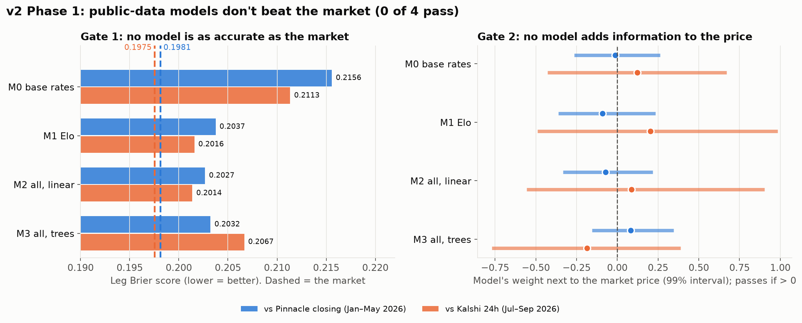
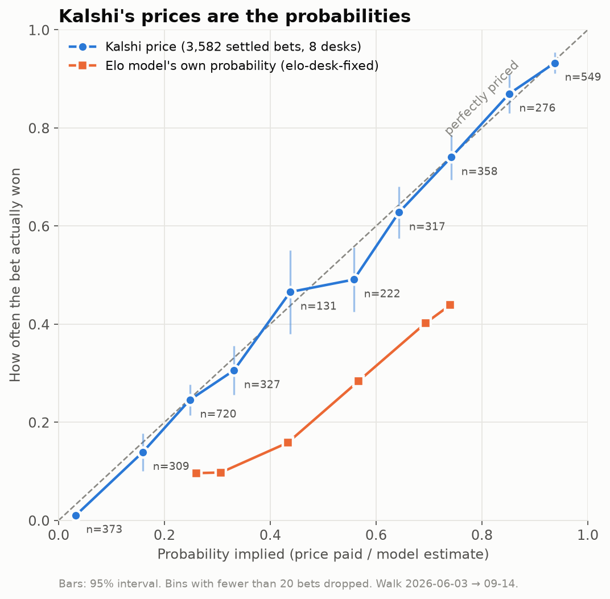
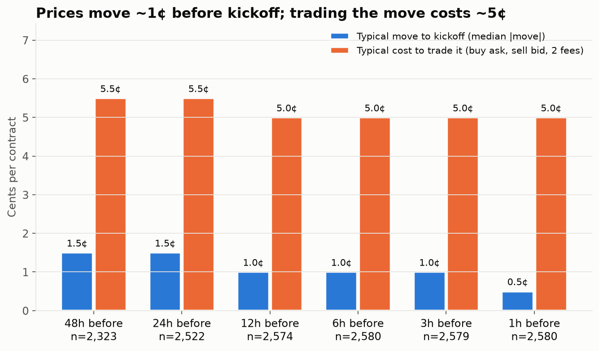
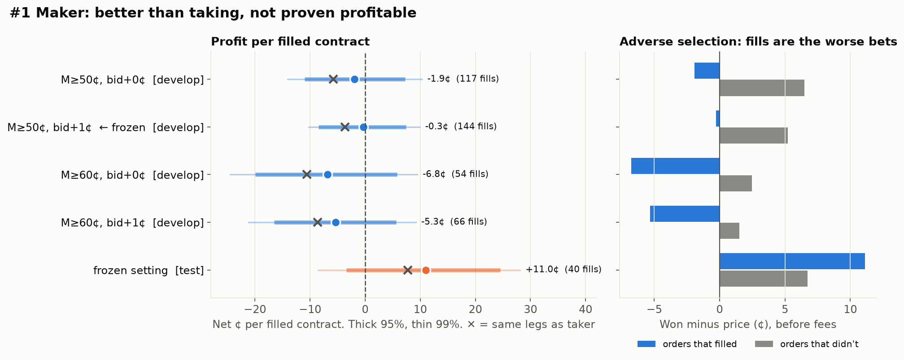

# Kalshi Trading — Autonomous Prediction-Market Betting System

An autonomous system that scans every open Soccer market on Kalshi (discovered live by tag, no hardcoded series list), prices each leg with a blend of structural Poisson/NegBin models + optional LLM + market data, sizes bets via Kelly with hard per-bet caps, and evolves a population of strategy agents through a genetic algorithm.

**Status:** v2.0.0 (research report, 2026-10-18). Trading system v4 (per-league brains, all-soccer). The droplet runs only the price collector; nothing is armed or trading. See [CLAUDE.md](CLAUDE.md) for agent instructions and [docs/REPORT_v2.0.md](docs/REPORT_v2.0.md) for the latest results.

## v2.0.0 — research report: public-data models don't beat Kalshi (2026-10-18)

**[📊 Full report → docs/REPORT_v2.0.md](docs/REPORT_v2.0.md)**

- **0 of 4 models beat the market:** best Brier 0.2027 vs Pinnacle closing 0.1981, 0.2014 vs Kalshi 0.1975.
- **0 of 4 add information** next to the price; **0 of 12** league-tier × entry-time groups pass (1,363 Kalshi games).
- **Public data is already in the price.** An edge has to come from information, not modelling.
- **Left open:** profit on selected bets (never tested), non-public information, other market types.



| Finding | Question | Answer |
|---|---|---|
| [07](docs/findings/07_PRICE_VS_MODEL.md) | Can a model ignore the price? | No: price +1.30, Elo −0.03 |
| [08](docs/findings/08_DATASET.md) | Dataset and bars to beat | Pinnacle 0.1981, Kalshi 0.1975 |
| [09](docs/findings/09_PHASE1_BASELINES.md) | Do baseline models beat the market? | 0 of 4 |
| [10](docs/findings/10_PHASE2_TIERS.md) | Is the market weaker in any tier or time? | 0 of 12 groups |

## v1.0.0 — research report: trading mechanics don't beat Kalshi (2026-09-28)

**[📊 Full report with every chart and test → docs/REPORT_v1.0.md](docs/REPORT_v1.0.md)** ·
**[Next chapter (v2): predict better, hold to settlement → docs/NEXT_CHAPTER_v2.md](docs/NEXT_CHAPTER_v2.md)**

- **Kalshi's prices are accurate probabilities:** 3,582 settled bets, 48.8¢ average price, 47.7% won.
- **Every trading desk lost money,** AI-managed and rule-based alike; doing nothing beat them all.
- **Prices move about 1.5¢ before kickoff; a taker round trip costs about 5.5¢.**
- **Pre-registered rule tests: 0 of 4 passed** (three-way arbitrage, longshots both ways, maker orders).
- **Makers save about 3.5¢ per bet** and pay no fee on 85 of 91 soccer series, but filled orders are the worse bets.





| Finding | Question | Answer |
|---|---|---|
| [01](docs/findings/01_MARKET_EFFICIENCY.md) | Can AI-managed desks beat the market? | No: prices ≈ probabilities; all desks lost |
| [02](docs/findings/02_MIDRANGE.md) | Is 40–60¢ mispriced? | A 40–45¢ hint, inside the noise |
| [03](docs/findings/03_PRICE_MOVES.md) | Can we trade the move to kickoff? | No: ~1.5¢ moves vs ~5.5¢ cost |
| [04](docs/findings/04_STRATEGY_IDEAS.md) | What does the literature suggest? | 12 ideas; maker > taker is the best-supported |
| [05](docs/findings/05_PREREG_BATCH1.md) · [06](docs/findings/06_BATCH1_RESULTS.md) | Do 4 rule-based strategies pass a pre-registered test? | 0 of 4 |

## Quick Start

```bash
cd ~/dev/kalshi-trading
source venv/bin/activate

# Paper arena status
python3 -m wc.arena --status

# Real-money pilot status
python3 -m wc.pilot_status

# Dry-run promoter (safe — no real orders)
python3 -m wc.promote
```

See [CLAUDE.md](CLAUDE.md) for the full runbook, architecture, and safety rules.

## Docs

| File | Purpose |
|------|---------|
| [docs/REPORT_v2.0.md](docs/REPORT_v2.0.md) | **v2.0 research report: public-data prediction models** |
| [docs/REPORT_v1.0.md](docs/REPORT_v1.0.md) | **v1.0 research report: all findings, tests and charts** |
| [docs/NEXT_CHAPTER_v2.md](docs/NEXT_CHAPTER_v2.md) | **v2 plan: prediction model, hold to settlement** |
| [CHANGELOG.md](CHANGELOG.md) | Version history |
| [CLAUDE.md](CLAUDE.md) | Agent instructions: architecture, runbook, ground rules |
| [docs/backtester/08_WALK_FORWARD.md](docs/backtester/08_WALK_FORWARD.md) | Walk-forward runner + AI desk managers |
| [RECAP.md](RECAP.md) | Older arena results + findings (2026-06-30) |
| [docs/v3_plan.md](docs/v3_plan.md) | v3 design: what exists, what's duplicated, what's still to build |
| [docs/BUILD_PLAN_V2.md](docs/BUILD_PLAN_V2.md) | Arena v2 original build plan (historical) |
| [docs/PROMOTION_BUILD_PLAN.md](docs/PROMOTION_BUILD_PLAN.md) | Promotion patch-panel design |
| [docs/DEPLOY_CLOUD.md](docs/DEPLOY_CLOUD.md) | Cloud deployment guide |
| [docs/CLAUDE.md](docs/CLAUDE.md) | Legacy 4-agent system docs (retired — v1/v2 reference) |
