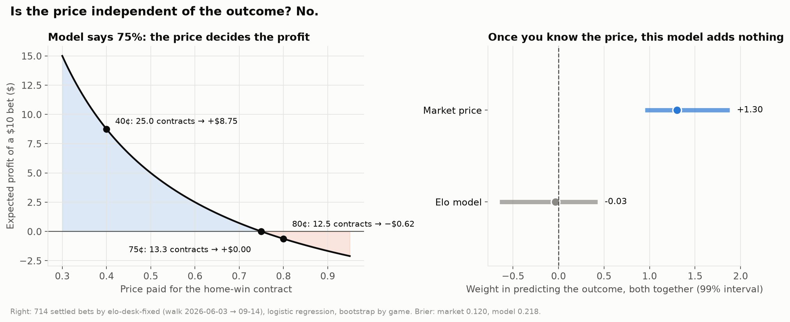
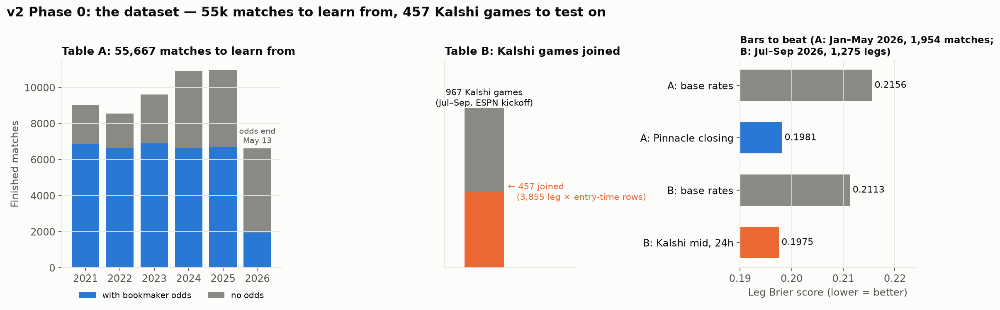
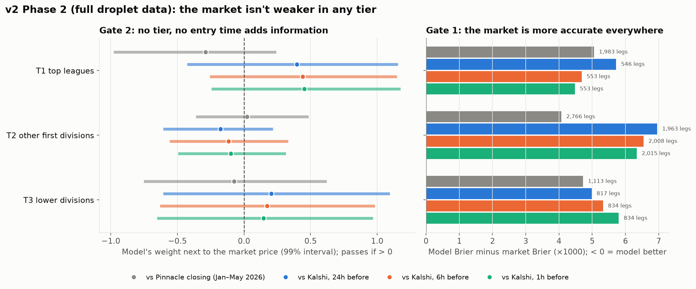

# Kalshi soccer — v2.0 research report

**Version 2.0.0 · 2026-10-18 · closes the "public-data prediction model" chapter**

The question for this chapter: *can a model built from public match data (Elo, form, goals,
shots, head-to-head, league rates) predict soccer results well enough to bet against Kalshi
and hold to settlement?*

**Answer: not with public data.** Four models were tested against two sharp markets (Pinnacle
closing and Kalshi), on held-out games, under rules fixed before each run. None was more
accurate than the market, and none added information to the market's price, in any league
tier or at any entry time.

**What this chapter did *not* test:** whether a model can make a profit on the games it
*chooses* to bet (Gate 3 in the plan). The gates were ordered so that profit was tested only
after information. Since nothing passed Gate 2, Gate 3 never ran. A model can be less accurate
than the market overall and still be profitable on a selected subset, but only if on that
subset it is more right than the price by more than the costs. That is where the next chapter
starts.

---

## TL;DR in five bullets

1. **The features are real, but the market already has them.** The best model closes about 70% of the gap between base rates and Pinnacle, and the market prices all of it.
2. **0 of 4 models beat the market** (Brier 0.2027 vs Pinnacle 0.1981; 0.2014 vs Kalshi 0.1975).
3. **0 of 4 models add information:** next to the market price, the model's weight is about 0.
4. **There's no weak spot:** 0 of 12 groups (league tier × entry time, 1,363 Kalshi games on the full droplet data) pass, and the market is more accurate in all 12.
5. **The price can't be ignored:** a model that picks winners regardless of price loses, because price and outcome are strongly linked (Finding 07).

---

## What was built in this chapter

| Piece | Where | What it does |
|---|---|---|
| Point-in-time dataset | `wc/research/dataset.py` | Rebuilds 23 features in one forward pass; no feature newer than the entry time (22 tests) |
| Table A | `data/research/v2_dataset.db` → `ds_matches` | 55,667 matches 2021 → Sep 2026; 35,693 with Pinnacle closing odds |
| Table B | `ds_kalshi` | Kalshi legs at 24h / 6h / 1h before kickoff, joined to match history |
| Models and gates | `wc/research/models.py` | M0–M3, Gate 1 (Brier, bootstrap by game) and Gate 2 (logit regression), 99% intervals |
| Full-data run | `scripts/run_phase2.sh` | Runs Phase 2 on a snapshot of the droplet's history DB (live DB only read) |
| Charts | `scripts/phase0_charts.py`, `phase1_charts.py`, `finding07_price_vs_model.py` | Every chart regenerated from data |

---

## 0. Can a model ignore the price? ([Finding 07](findings/07_PRICE_VS_MODEL.md))



- Profit per $ = model probability ÷ price − 1, so **the price is always in the answer**.
- On 714 settled bets: market coefficient **+1.30**, Elo model **−0.03**. Once the price is known, the model adds nothing.
- **So stakes follow the edge (p̂ − price), not p̂.**

## 1. The dataset ([Finding 08](findings/08_DATASET.md))



| Table | Period | Base rates | Market (the bar) |
|---|---|---|---|
| A | Jan–May 2026, 1,954 matches | 0.2156 | **Pinnacle closing 0.1981** |
| B | Jul–Sep 2026, 1,275 legs at 24h | 0.2113 | **Kalshi mid 0.1975** |

- Pinnacle closing is the sharpest public price, so it is a **hard, honest bar**.
- Kalshi and Pinnacle are about equally accurate.

## 2. Baseline models ([Finding 09](findings/09_PHASE1_BASELINES.md))


| Model | Brier vs Pinnacle | Brier vs Kalshi 24h | Adds information? |
|---|---|---|---|
| M0 base rates | 0.2156 vs **0.1981** | 0.2113 vs **0.1975** | ✗ |
| M1 Elo, recalibrated | 0.2037 | 0.2016 | ✗ |
| M2 all features, linear | **0.2027** | **0.2014** | ✗ |
| M3 all features, trees | 0.2032 | 0.2067 | ✗ |

- Trees are no better than the linear model. **Model complexity isn't the bottleneck; information is.**
- The last ~30% of the gap is what the market knows and we don't: lineups, injuries, motivation, sharp money.

## 3. Is the market weaker anywhere? ([Finding 10](findings/10_PHASE2_TIERS.md))



- Full droplet data: **1,363 Kalshi games, about 3,400 legs per entry time.**
- **Lower divisions aren't easier.** **Entry time doesn't matter** (24h = 6h = 1h).
- Top tier on Kalshi showed +0.4 at every entry time. But it's the same ~188 games each time, every interval includes 0, and the same tier is −0.29 against Pinnacle. **Not a signal.**

---

## What we learned

- **Public data is already in the price.** Elo, form and goals are worth a lot, but everyone has them.
- **Pinnacle closing and Kalshi are about equally sharp** on soccer winner markets.
- **Thin leagues aren't sloppy.** We expected the market to be weaker in Bolivia than in the EPL; it isn't.
- **An edge has to come from information, not modelling.** Better algorithms on the same inputs didn't help.
- **The process worked.** Each protocol was committed before its run, and the data told us "no" cleanly instead of letting us fool ourselves.

## What this chapter left open

- **Gate 3, profit on selected bets, was never run.** Accuracy over all games is a stricter test than profit over chosen games. The next chapter tests profit directly.
- **No non-public information was tried:** lineups, injuries, news, weather, or an LLM reading them.
- **Markets other than the three-way winner weren't tested:** totals, both teams to score, futures, in-play.
- **Kalshi vs Pinnacle as a source of edge wasn't tested:** we used Pinnacle as a benchmark, not as a signal to bet Kalshi with.

## Limitations (read before quoting any number)

- **Table B coverage:** 1,363 of 4,648 droplet Kalshi games join to match history. Leagues `soccer.db` doesn't know (Bolivia, Chile, Paraguay, Belgium, …) are missing.
- **Pinnacle odds end 2026-05-13,** so the Pinnacle and Kalshi tests use different games.
- **Hourly bars;** mid price used as the market's probability.
- **Kalshi settles on 90 minutes:** extra-time and penalty games count as draws.
- **Droplet code is rsync-deployed, not git:** the Phase 2 run used `scripts/run_phase2.sh` from this branch.

## Reproduce

```bash
python -m wc.research.dataset                 # Phase 0: Tables A + B (~3 s)
python scripts/phase0_charts.py
python -m wc.research.models                  # Phase 1 (~1 min)
python scripts/phase1_charts.py
bash scripts/run_phase2.sh                    # Phase 2, on the droplet (full data)
python scripts/finding07_price_vs_model.py
```
