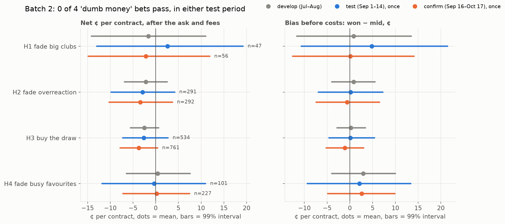

# Finding 12: Batch 2 results — does dumb money leave a mark on the price?

Pre-registration: [11_PREREG_BATCH2.md](11_PREREG_BATCH2.md) (rules committed before any run).
Data: droplet snapshot, 7,622 settled games to 2026-09-29. Develop: 2,949 games through Aug 31.
Test: games closing Sep 1–29, **run once** with the settings frozen in `results/batch2_frozen.json`.

> **Correction (2026-10-19):** the test read only the hourly backfill, which ends Sep 14. The 730
> games after that had no prices and got no bets, so **the test was effectively Sep 1–14** (about
> 970 games), not Sep 1–29. A confirmation run on Sep 16 → Oct 19 with the same frozen settings is
> pre-registered in [11_PREREG_BATCH2.md](11_PREREG_BATCH2.md) (addendum 2026-10-19).
Run: `python -m wc.research.batch2 develop`, commit, `python -m wc.research.batch2 test`,
then `python scripts/batch2_charts.py`.

**Result: 0 of 4 pass.** None of the four casual-bettor mistakes shows up in the price clearly
enough to profit from, or even to measure.

| | Bet (frozen setting) | Test bets | Net ¢ / contract, 99% | Bias before costs | Random entry | Verdict |
|---|---|---|---|---|---|---|
| H1 | NO on big clubs, 6h before | 47 | +2.6 [−13.0, +19.2] | +4.8 | +3.4 | ❌ too few bets (< 50), interval crosses 0 |
| H2 | Against a team after a ≥3-goal result | 291 | −2.9 [−9.8, +4.2] | +0.2 | +0.2 | ❌ |
| H3 | YES on the draw, mid ≥ 25¢, 6h before | 534 | −2.6 [−7.3, +2.7] | +0.1 | −3.5 | ❌ |
| H4 | NO on the favourite, top 10% busiest games | 101 | −0.3 [−11.8, +11.0] | +2.1 | −2.6 | ❌ |

## What it says

- **Draws aren't underpriced.** With 534 test bets, plus 1,386 on develop, draws win almost exactly as often as priced (bias +0.1¢). Buying them loses the spread and fee, about −2.6¢. This is the clearest "no" of the four.
- **No overreaction to big wins or losses.** Bias +0.2¢ on 291 bets. The market already prices the last result correctly.
- **Big clubs: too few games to tell.** Only 47 test bets. The direction fits the idea (+4.8¢: big clubs won a bit less often than priced), but the interval runs from −11 to +21. This would need about 10× the games.
- **Busy games: the direction fits, but the size is noise.**
  - In the busiest 10% of games, favourites won **2.1¢ less often than priced**. In quiet games they won **1.3¢ more often**.
  - That is what the "public backs the favourite" idea predicts. But both intervals cross 0 (busy −13 to +9, quiet −3 to +6), and the gap is smaller than the taker cost.

## The answer to the premise

- **Casual money doesn't visibly bend Kalshi soccer prices** in the four places we'd most expect it.
- This fits the market-maker story. Casual bettors are filled close to the fair price and lose through the spread and fees, not through a bent price. **Their losses go to whoever provides the liquidity, not to other takers.**
- **So if there is money to be made from casual bettors, it is probably as the maker,** posting orders they trade against. Batch 1 found that makers save about 3.5¢ per bet and that 85 of 91 series charge makers no fee. It also found the filled orders were the worse bets.

## Limits

- **Power:** a 1¢ edge needs about 1,900 bets to detect. H1 and H4 are far short of that, so a fail there means "not detected", not "not there".
- **Hourly bars, taker at the ask:** a real order could do a little better or worse.
- **Survivorship:** the archive only includes markets Kalshi still lists.
- **Overlap:** the test period overlaps the Phase 2 data and Batch 1's test, but none of these rules had been run on any data before.
